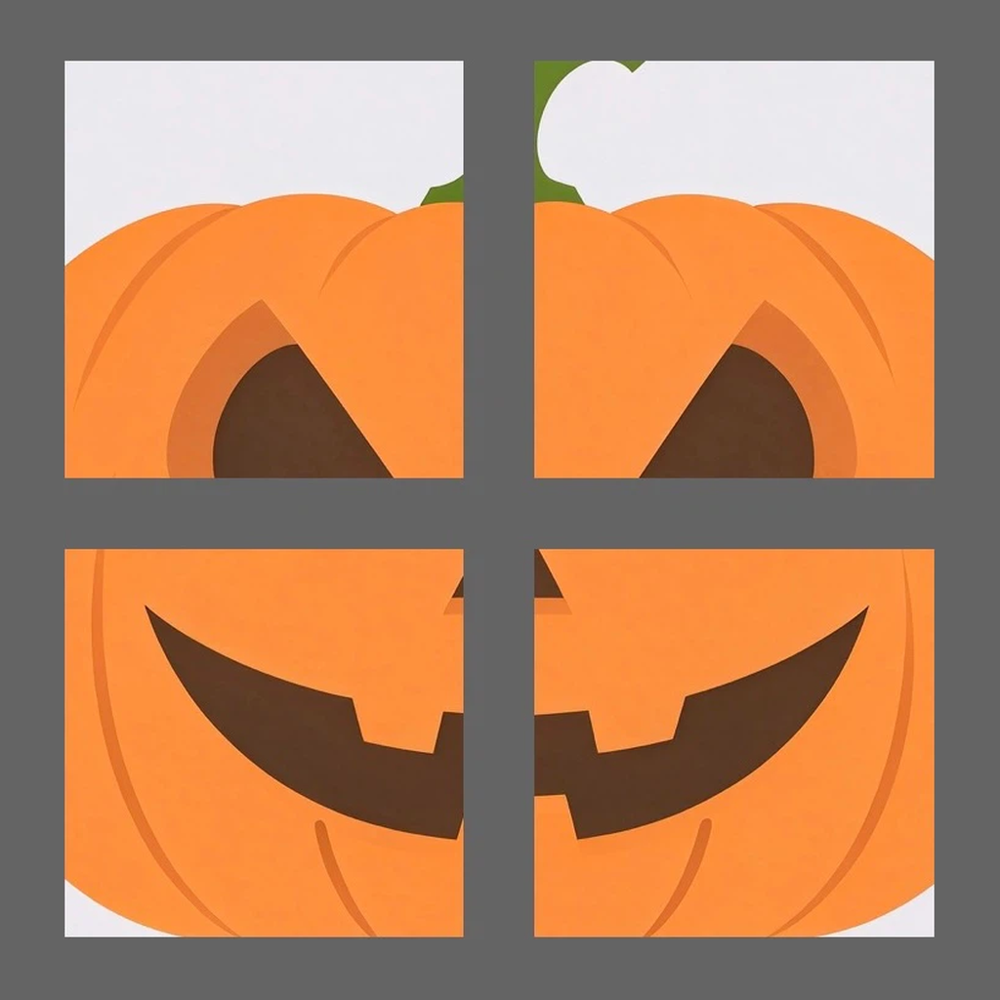

<p align="center">
  
</p>

<h1 align="center">HaloWin</h1>

<p align="center">Windows 11 ARM64 on an iPad — no hypervisor, no Mac.</p>

<p align="center">
  <a href="#getting-a-build">Getting a build</a>
  ·
  <a href="docs/architecture.md">How it works</a>
  ·
  <a href="../../releases/latest">Releases</a>
  ·
  <a href="docs/licensing.md">Licence</a>
</p>

A jack-o'-lantern in a four-pane window: Halloween and Windows in one mark.

HaloWin is an arm64 virtual machine that lives inside an iOS app — its own JIT,
its own MMU, its own devices, its own UEFI firmware. The guest is Windows 11
ARM64. iOS gives apps no hypervisor, so none is used: the guest's code is
translated and run on the device's own cores.

> **Status: not usable yet.** The firmware boots, `bootmgfw.efi` runs and hands
> over to `winload`, and the loader gets far enough to build its own page tables
> — then it stops on a memory access the emulated MMU rejects. That fault is what
> this tree is currently chasing. There is no Windows desktop to look at yet.

## What it is, and what it is not

HaloWin is a fork of an existing emulator, pointed at Windows instead of macOS.
The upstream project is Henge by Leviidev and contributors (GPL-2.0-or-later),
and its notices and licence are kept unchanged here. What changed in this fork:

- macOS is no longer a target. The guest is Windows 11 ARM64 only.
- The MMU is 4 KB granularity rather than 16 KB. macOS wants 16 KB pages, Windows
  wants 4 KB, and this fork pays the cost of the smaller TLB on purpose.
- The machine presented is a small PC: one CPU, 6 GB of RAM, PCIe with MSI-X,
  GICv3 with ITS, ACPI tables, `fw_cfg`, pflash firmware, virtio devices and an
  xHCI controller.
- The app is Windows-specific: one machine, one boot button, one console, and
  diagnostics built for a boot that hangs.

The upstream name, logo, website and copy belong to the upstream project and are
not used here. HaloWin is a separate project — **not affiliated with, sponsored
by or endorsed by** the upstream authors, or by Apple, Microsoft or any other
vendor whose software it runs.

## Getting a build

Builds come out of CI, not out of a Mac. Every push to `main` runs
[`.github/workflows/build-henge.yml`](.github/workflows/build-henge.yml) on a
GitHub-hosted macOS runner and publishes the result as release assets on the
[`latest` release](../../releases/latest):

- **`HaloWin.ipa`** — unsigned / ad-hoc signed, for SideStore or AltStore, which
  re-sign it with your certificate on install.
- **`HaloWin.tipa`** — for TrollStore.

Those assets are the IPA files themselves, not a zip containing an IPA: release
assets are served as the file, while workflow artifacts always arrive
compressed.

A build tuned to one core is published separately, on the
[`variants` release](../../releases/tag/variants), as `HaloWin-<core>.ipa` — for
example `HaloWin-A18-M4.ipa`, since M4 is A18 silicon. Cores that share silicon
share one build and one name: `A10X` (the A10 cores are A10X's too, and only
A10X devices run iOS 17), `A12-A12X`, `A14-M1`, `A15-M2`, `A16-M3`, `A18-M4`.
M5 is its own core and its own build. M6 and A20 Pro are newer than Xcode's clang
knows, so they are built with an LLVM 24 nightly when one is pointed at.

The workflow runs as one of two things: `only_m4`, the iPad this is developed
on, or the whole list (`A10X`, `A11`, `A12-A12X`, `A13`, `A14-M1`, `A15-M2`,
`A16-M3`, `A17Pro`, `A18-M4`, `A18Pro`, `A19`, `A19Pro`, `A20Pro`, `M5`, `M6`),
fifteen builds. Each build's real flags land in `flags.csv` beside the IPAs, because
a core flag the compiler does not know silently falls back to an architecture
tier. The deployment floor is iOS 17: an A10-silicon build installs on A10X
devices (iPad Pro 2nd gen), not on the iPhone 7 (15.8) or iPad 6 (16.7) that
share those cores.

On the device you need:

- **JIT.** iOS will not run the generated code without it — StikDebug, TrollStore,
  or a jailbreak. (The app used to ship its own debugger extension; it is gone,
  as StikDebug covers the case on every supported iOS.)
- iOS or iPadOS 17 or later, on an A14 or M1 chip or newer.
- **RAM, as a slider and a box.** 256 MB up to whatever the machine itself has,
  and there is no ceiling written into the app: a 3 GB iPad stops at 3 GB, while
  PlayCover on a 512 GB Mac Studio offers 512 GB and a 2 TB or 6 TB cluster node
  offers all of it. The notches are a ladder rather than a fixed step: 256, 384,
  512, 768, then 1 GB hops to 10 GB, and from there the step doubles once it is
  an eighth of the current size -- 2 GB to 16 GB, 4 GB to 32 GB, 8 GB to 64 GB,
  16 GB to 128 GB, 32 GB to 256 GB, 64 GB to 512 GB, 128 GB to 1 TB, 256 GB to
  2 TB. The slider snaps to the nearest notch; the box beside it takes any number
  in megabytes (1145 is a real answer) and the handle parks on the nearest notch
  to it.
- Free storage for the Windows image you boot.
- A signing certificate carrying the *increased memory limit* entitlement if you
  have one; without it the guest RAM is file-backed and much slower.

Then open the app, pick your image, and boot. It writes `henge.log` and
`henge-native.log` into its Documents folder — read those first if the boot
stalls.

## Building it yourself

```sh
zsh ios/scripts/fetch_deps.sh
zsh tools/build_ios_restore.sh
make ios-lib                                    # engine, -O2 with line tables
zsh ios/scripts/package_ipa.sh                  # HaloWin.ipa (ad-hoc signed)
zsh ios/scripts/package_ipa.sh --trollstore     # HaloWin.tipa
```

**Debug or release build.** `DEBUG=1` is the default: `-O2` and line tables, which
is what the addresses in `henge.log` are read against. `DEBUG=0` is the shipping
build: `-O3` plus LTO across the engine, the C files Xcode compiles and the link.
It moves the timing around and inlines across files, so it is not what the boot
stalls are diagnosed on.

```sh
DEBUG=0 make ios-lib
DEBUG=0 zsh ios/scripts/package_ipa.sh
```

Objects never get shared between the two: `DEBUG=0` builds into `build/ios-rel`
(`build/ios-m4-rel` for a per-core build), and `make print-ib` prints the
directory the current settings use.

The engine also builds and tests on a Mac host, without an iOS device:

```sh
sh compat/build-and-test.sh
```

## Diagnostics

A boot that hangs is the normal case here, so the emulator is built to be
readable rather than mysterious:

- **`henge.log`** — one timeline: PC samples with instruction counts, block and
  TLB statistics, every fault the guest took, and every page-table walk that came
  up short — level by level, read as physical memory.
- **`stall-mem-<pc>.bin`** — when a CPU has not left one PC for five seconds, 40 MB
  around it is written out: code, stack, and page tables. A page that cannot be
  reached through the guest's current address space is read as physical memory
  instead, because page tables are exactly the memory a broken address space does
  not map.
- **`stall-stack-<pc>.bin`** — the stack alone, plus the words on it that point
  back into the code.
- **`HV_STATS`, `HV_HZ`, `HV_FLUSH`, `HV_XHCI_TRACE`** — knobs read at launch.
  `HV_XHCI_TRACE` is off unless you ask for it.

## Known limits

- Windows does not reach a desktop. Boot currently ends in the loader.
- One CPU. SMP is not implemented.
- No audio, no camera, no USB passthrough, and no GPU acceleration beyond a
  framebuffer.
- It is emulation: the guest runs on translated code, not on the device's cores.

## The projects this stands on

HaloWin is possible because other people published their work. It is built on,
derived from, or modelled on these projects, and this is the credit they are owed:

- **[Henge](https://github.com/Leviidev/Henge)** — the emulator this tree is a
  fork of: JIT, MMU, devices, the iOS host layer. GPL-2.0-or-later. Its notices
  and licence are kept as they were.
- **[WindowsiOS](https://github.com/ammaarreshi/WindowsiOS)** — a Windows-targeted
  fork of Henge by Ammaar Reshi, GPL-2.0. It is the same lineage as this tree, and
  the Windows side of the boot — the firmware identity, the ACPI tables, the
  machine description Windows is handed, and part of the Windows UI scaffolding —
  follows what it established. The ACPI tables this build presents still name it.
- **[UTM](https://github.com/utmapp/UTM)** — the iOS virtual-machine app, Apache-2.0.
  Its on-screen keyboard accessory (the Esc/Ctrl/Option/Command row, the sticky-key
  behaviour) is the model for HaloWin's Windows key bar; the style and interactions
  are UTM's.
- **[virglrenderer, UTM's `neptune` branch](https://github.com/utmapp/virglrenderer)**
  — MIT. The 3D path, when it is wired up, is built around this renderer rather
  than around a new one.
- **[UTM's QEMU fork](https://github.com/utmapp/qemu)** — GPL-2.0. The virtio-gpu
  device design, the ISO-as-bytes boot assumption and the Windows-on-ARM machine
  layout are read from here and from upstream QEMU; see
  [docs/licensing.md](docs/licensing.md) for the file-by-file list.

Being listed here is credit, not endorsement. None of these projects is
affiliated with HaloWin, and none of them has reviewed or approved it.

## Licence and credits

HaloWin is **GPL-2.0-or-later**, the same terms as upstream. The shipped binary is
a combined GPL work — usbmuxd and code from Husk are compiled into it — so it
cannot go on the App Store.

- Upstream work: Henge, Copyright (C) the Henge authors (Leviidev and
  contributors), GPL-2.0-or-later — [LICENSE](LICENSE).
- Changes in this fork: Copyright (C) 2026 qibaoseven, GPL-2.0-or-later —
  [LICENSE-qibaoseven](LICENSE-qibaoseven).
- Component-by-component provenance — QEMU-derived device code,
  libimobiledevice, libzip, Mbed TLS, StikJIT and the rest —
  [docs/licensing.md](docs/licensing.md).

Upstream's notices are untouched. Nothing in this fork narrows or replaces them.
Windows, macOS, iPhone and iPad are trademarks of their owners; the project name,
icon and text of HaloWin are its own.

## Names inside the code

The project is HaloWin. The code still carries its upstream identifiers — the
bundle id `com.henge.app`, the `henge` log prefix, the `henge-agent` helper, and
build products named from them — because those are bound to code signing,
reinstall paths and data already on devices. Renaming the bundle is a separate,
riskier change than renaming the project; the published release assets already
use the project's own name.
</content>
</file_path>
